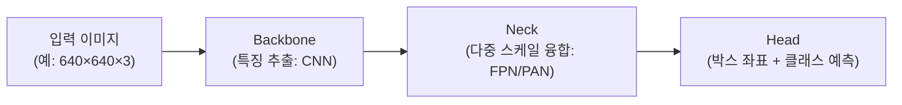
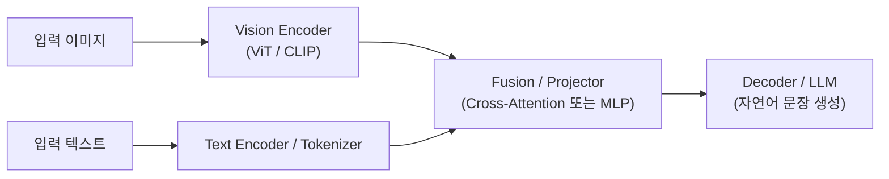

# VLM과 YOLO 개념, 네트워크 구조 및 차이점

## 1. YOLO (You Only Look Once)

### 1.1 개념과 등장 배경
[YOLO](https://arxiv.org/abs/1506.02640)는 입력 이미지에서 객체의 **위치**(Bounding Box)와 **종류**(Class)를 동시에 예측하는 **객체 탐지(Object Detection)** 모델임.

기존 2-Stage 방식과 1-Stage 방식의 구조 차이는 다음과 같음.
- **2-Stage Detector (예: Faster R-CNN):** 1단계에서 객체가 있을 법한 후보 영역을 먼저 제안(Region Proposal)하고, 2단계에서 각 후보 영역을 개별적으로 분류(Classification)함. 정확도는 높지만 영역별 연산이 반복되어 추론 속도가 느림.
- **1-Stage Detector (YOLO):** 영역 제안과 분류를 나누지 않고, 이미지를 신경망에 **단 한 번 통과**(Single Forward Pass)시켜 위치 회귀와 클래스 분류를 동시에 처리함([CVPR 2016](https://www.cv-foundation.org/openaccess/content_cvpr_2016/papers/Redmon_You_Only_Look_CVPR_2016_paper.pdf)). 이 구조 덕분에 초당 수십~수백 프레임(FPS)의 실시간 탐지가 가능함.

### 1.2 YOLO 네트워크 구조 (Backbone - Neck - Head)

[Ultralytics YOLO](https://docs.ultralytics.com/guides/yolo-architecture) 기준 내부 신경망은 3단계로 나뉨.



1. **Backbone (특징 추출기)**
   - 입력 이미지에서 윤곽선·질감 같은 저수준 특징부터 객체 형태 같은 고수준 특징까지 계층적인 특징 맵(Feature Map)을 추출함([Ultralytics Backbone](https://www.ultralytics.com/glossary/backbone)).
   - 합성곱(Convolution) 계층을 통과하며 공간 해상도는 줄어들고 채널(깊이)은 확장됨. Darknet, CSPDarknet 같은 CNN 구조가 쓰임.
2. **Neck (다중 스케일 특징 융합기)**
   - 백본의 앞쪽 층은 해상도가 높아 **작은 객체의 위치 정보**가 잘 유지되고, 뒤쪽 층은 **객체의 의미 정보**가 풍부함.
   - 깊은 층의 의미 정보를 하위로 전달하는 [**FPN**](https://arxiv.org/abs/1612.03144)과, 얕은 층의 위치 정보를 상위로 다시 올려주는 [**PANet**](https://arxiv.org/abs/1803.01534)을 결합해 크기가 다른 객체들을 모두 안정적으로 탐지함.
3. **Head (최종 예측기)**
   - Neck에서 융합된 특징 맵을 받아 최종 **Bounding Box 좌표 `(x, y, w, h)`**, **신뢰도(Confidence)**, **클래스 확률**을 출력함([Ultralytics Head](https://www.ultralytics.com/glossary/detection-head)).

### 1.3 예측 및 학습 메커니즘 (그리드, 손실 함수, NMS)

- **그리드(Grid) 분할:** 입력 이미지를 `S × S` 격자로 분할함. 객체 중심점이 포함된 격자 셀이 해당 객체 예측을 담당함.
  - 예(YOLOv1): `7 × 7` 격자에서 셀당 박스 `B = 2`개(각 `x, y, w, h, Confidence` 5개 값)와 클래스 `C = 20`개를 예측하면 출력 텐서 크기는 `7 × 7 × (2 × 5 + 20) = 7 × 7 × 30`이 됨.
- **신뢰도 점수 (Confidence Score):** 박스 내 객체 존재 확률과 예측 박스·정답 박스의 겹침 비율(**IoU**, Intersection over Union)을 곱해 계산함.
  ```text
  Confidence = Pr(Object) × IoU(pred, truth)
  ```
- **손실 함수 (Loss Function, YOLOv1 기준):** 위치 오차, 신뢰도 오차, 분류 오차를 하나의 식으로 합쳐 역전파함. (최신 YOLOv8/v11에서는 위치 회귀에 `CIoU + DFL`, 분류에 `BCE` 손실을 사용함)
  - **위치 오차:** 박스 너비·높이 `(w, h)`에 제곱근(`√w`, `√h`)을 씌워 오차를 계산함. 동일한 픽셀 오차라도 대형 객체보다 소형 객체에 미치는 영향이 훨씬 크기 때문에, 작은 박스의 오차에 더 큰 가중치를 주기 위함임.
  - **신뢰도 오차:** 이미지 대부분이 객체가 없는 배경 셀이므로, 클래스 불균형으로 인한 학습 편향을 막기 위해 배경 셀 오차에는 작은 가중치(`λ_noobj = 0.5`)를 곱함.
  - **분류 오차:** 객체가 존재하는 셀에 한해 정답 클래스 예측 오차를 계산함.
- **NMS (Non-Maximum Suppression):** 동일 객체 주위에 겹쳐 생성된 중복 박스를 제거하는 후처리 과정임. 신뢰도가 가장 높은 박스를 기준으로 IoU가 임계값 이상 겹치는 박스들을 순차적으로 제거함.

### 1.4 YOLO 버전별 네트워크 변화 (v1 ~ v11)
- **YOLOv1:** 24개 합성곱 층 + 2개 완전 연결(FC) 층 구조. FC 층 때문에 입력 이미지 해상도가 고정되는 한계가 있었음.
- **YOLOv2 (Darknet-19):** FC 층을 제거한 완전 합성곱 구조(FCN)로 가변 해상도 입력을 지원함. 배치 정규화(Batch Normalization)와 사전 정의 기준 박스의 오프셋을 예측하는 **Anchor Box**를 도입함.
- **YOLOv3 (Darknet-53):** 잔차 연결(Residual Connection)을 적용해 층을 깊게 쌓았고, FPN 기반 3가지 해상도(`13×13`, `26×26`, `52×52`)에서 각각 예측하며 소형 객체 탐지 성능을 개선함.
- **YOLOv4 ~ v5 (CSPDarknet53):** 특징 맵을 두 갈래로 나눠 한쪽만 연산 후 병합하는 CSPNet 구조를 적용해 연산량을 줄이면서 기울기(Gradient) 흐름을 개선함.
- **YOLOv8 (C2f, Decoupled Head, Anchor-Free):** 기울기 흐름을 보강한 `C2f` 모듈을 사용하고, 헤드에서 위치 회귀와 클래스 분류 가지를 분리함(**Decoupled Head**). 또한 앵커 박스 설계를 없애고 중심점에서 네 변까지의 거리를 직접 예측하는 **Anchor-Free** 방식으로 전환함([YOLOv8](https://docs.ultralytics.com/models/yolov8)).
- **YOLOv10 (NMS-Free, Dual Assignments):** 학습 시 One-to-Many와 One-to-One 라벨 할당을 병행해 추론 단계의 NMS 후처리를 제거하고 추론 지연 시간을 단축함([YOLOv10](https://arxiv.org/abs/2405.14458)).
- **YOLOv11 (C3k2, C2PSA):** `C2f`를 경량·고효율 `C3k2` 블록으로 개선하고, 백본 말단에 공간 어텐션 모듈(`C2PSA`)을 추가해 적은 파라미터로도 소형·밀집 객체 탐지 정확도를 높임([YOLO11](https://docs.ultralytics.com/models/yolo11)).

---

## 2. VLM (Vision-Language Model)

### 2.1 개념과 원리
[VLM](https://en.wikipedia.org/wiki/Vision-language_model)은 이미지(시각)와 텍스트(언어) 두 가지 모달리티를 함께 이해하고 처리하는 멀티모달 모델임.

픽셀 배열인 이미지와 단어 시퀀스인 텍스트는 서로 다른 데이터 구조를 가지므로, VLM은 두 데이터를 **공통 임베딩 공간**(Common Embedding Space)으로 투영해 정렬(Alignment)함. 같은 의미를 나타내는 이미지 특징 벡터와 텍스트 임베딩 벡터가 공간 상에서 가까운 위치에 놓이도록 학습하는 것이 핵심임.

### 2.2 VLM 네트워크 구조 (Encoders - Fusion/Projector - Decoder)

VLM은 **인코더 → 융합/연결 네트워크 → 디코더(LLM)** 3단계로 구성됨([LLaVA Architecture](https://mbrenndoerfer.com/writing/llava-architecture-visual-instruction-tuning)).



1. **Encoders (모달리티별 특징 추출)**
   - **Vision Encoder:** 주로 [**ViT(Vision Transformer)**](https://arxiv.org/abs/2010.11929)를 사용함. 이미지를 `14×14` 또는 `16×16` 크기의 패치(Patch)로 분할한 뒤, 패치 간 Self-Attention 연산으로 전역적 시각 특징 벡터를 추출함. 사전 학습된 [CLIP](https://arxiv.org/abs/2103.00020)이나 [SigLIP](https://arxiv.org/abs/2303.15343)의 비전 인코더가 주로 쓰임.
   - **Text Encoder / Tokenizer:** 입력 텍스트를 토큰 단위로 분할하고 의미가 반영된 임베딩 벡터로 변환함.
2. **Fusion Network / Projector (시각-언어 결합)**
   - 비전 인코더 출력 차원과 언어 모델 토큰 차원을 맞추고 두 모달리티를 연결하는 구간임.
   - **Cross-Attention:** 텍스트 토큰과 이미지 패치 간의 연관성(Attention Weight)을 직접 계산해 융합함([BLIP-2](https://arxiv.org/abs/2301.12597)의 Q-Former 등).
   - **MLP Projector:** 1~2층 MLP를 거쳐 이미지 패치 벡터를 언어 모델의 토큰 차원으로 직접 투영함([LLaVA](https://arxiv.org/abs/2304.08485) 등).
3. **Decoder / LLM (자연어 생성)**
   - 결합된 시각 토큰과 텍스트 프롬프트 토큰을 함께 입력받아, 이전 토큰들을 바탕으로 다음 토큰을 순차적으로 예측하는 **자기회귀(Autoregressive)** 방식으로 문장을 생성함.

### 2.3 주요 수행 태스크
- **시각적 질의응답 (VQA):** 이미지와 자연어 질문을 함께 입력받아 장면을 해석한 답변을 생성함.
- **이미지 캡셔닝 (Image Captioning):** 이미지 속 객체 간 관계와 배경 맥락을 자연어 문장으로 서술함.
- **텍스트 기반 이미지 검색 (Image Retrieval):** 자연어 쿼리와 임베딩 유사도가 가장 높은 이미지를 검색함.

---

## 3. YOLO와 VLM의 차이점

### 3.1 입출력 및 태스크 비교

| 비교 항목 | YOLO | VLM |
| :--- | :--- | :--- |
| **입력 형태** | 단일 모달 (이미지) | 멀티모달 (이미지 + 텍스트) |
| **출력 형태** | 정형 3차원 텐서 (`x, y, w, h`, 신뢰도, 클래스) | 자연어 텍스트 토큰 스트림 (문장, 답변) |
| **인식 범위** | **Closed-Set** (학습된 고정 클래스만 탐지, 추가 시 재학습 필요) | **Open-Vocabulary** (미학습 객체나 복합 상황도 프롬프트로 추론) |
| **핵심 목적** | 객체의 정확한 위치 좌표와 클래스의 고속 탐지 | 장면 맥락 이해, 질의응답, 자연어 설명 생성 |

### 3.2 네트워크 구조 차이 (Backbone–Neck–Head vs Encoders–Fusion/Projector–Decoder)

YOLO와 VLM은 모두 3단계 파이프라인으로 구성되지만, 각 단계가 처리하는 대상(단일 모달 공간 특징 vs 이종 모달리티 정렬)과 출력 방식이 근본적으로 다름.

| 단계 / 비교 항목 | YOLO (`Backbone – Neck – Head`) | VLM (`Encoders – Fusion/Projector – Decoder`) |
| :--- | :--- | :--- |
| **1단계: 특징 추출** | **Backbone** — 단일 이미지에서 해상도별 계층적 공간 특징 맵(Feature Map)을 추출 | **Vision Encoder + Text Encoder/Tokenizer** — 이미지 패치와 텍스트 토큰을 각각 별도 인코더로 임베딩 |
| **2단계: 특징 융합·연결** | **Neck (`FPN/PAN`)** — 같은 이미지 내부의 **다중 스케일**(얕은 층의 위치 정보 + 깊은 층의 의미 정보)을 결합 | **Fusion / Projector (`Cross-Attention`, `MLP`)** — 서로 다른 **시각·언어 두 모달리티**의 차원과 의미 공간을 정렬·결합 |
| **3단계: 최종 출력** | **Head** — 격자/특징 맵 위치별 BBox 좌표 `(x, y, w, h)`, 신뢰도, 고정 클래스 확률을 **단일 순전파로 병렬 예측** | **Decoder / LLM** — 결합된 시각·텍스트 토큰을 바탕으로 다음 자연어 토큰을 **자기회귀(Autoregressive) 방식으로 순차 생성** |
| **후처리 / 디코딩** | NMS(Non-Maximum Suppression)로 중복 박스 제거 (v10 이후 NMS-Free 가능) | Greedy / Beam Search / Top-p 샘플링 등 텍스트 디코딩 전략으로 문장 완성 |

### 3.3 핵심 연산 백본 차이 (CNN vs Transformer)

위 네트워크 구조를 구성하는 기본 연산 블록에서도 YOLO는 주로 CNN 계열을, VLM은 Transformer 계열을 채택함에 따라 다음과 같은 연산·배포 특성이 갈림.

| 비교 항목 | YOLO (CNN 기반) | VLM (Transformer 기반) |
| :--- | :--- | :--- |
| **핵심 연산** | 합성곱(Convolution) 커널 및 FPN/PAN | Self-Attention 및 Cross-Attention |
| **수용 영역 (Receptive Field)** | 좁은 국소 영역(Local)에서 시작해 층이 깊어지며 확대 | 첫 층부터 이미지 전체 패치를 연관 짓는 전역(Global) 파악 |
| **귀납적 편향 (Inductive Bias)** | **높음** — 공간적 지역성과 이동 불변성이 구조에 내장되어 적은 파라미터로도 효율적 학습 가능 | **낮음** — 구조적 사전 가정이 적어 대규모 사전 학습 데이터와 큰 모델 규모에 의존 |
| **추론 속도 (Latency)** | 단일 순전파(Single-Pass) 병렬 연산으로 **수 ms** 수준 | 토큰 단위 자기회귀 생성 및 KV 캐시 참조로 **수백 ms ~ 수 초** 소요 |
| **하드웨어 환경** | 메모리 접근이 정형화되어 엣지 기기(Jetson 등) 배포에 유리 | 파라미터 규모와 메모리 대역폭 요구가 커 고성능 GPU 인프라 필요 |
