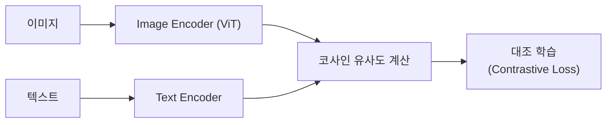
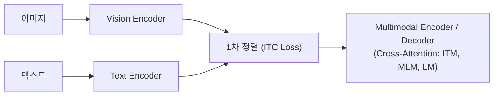
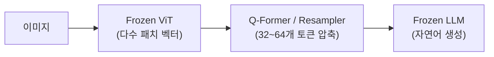
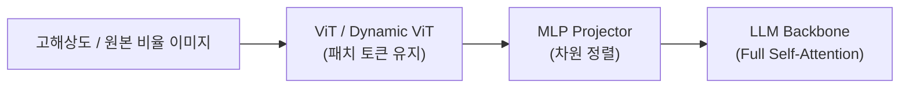

# VLM 주요 종류, 아키텍처별 차이점 및 모델별 장단점

[VLM(Vision-Language Model)](https://en.wikipedia.org/wiki/Vision-language_model)은 이미지와 텍스트를 결합하는 구조와 출력 목적에 따라 크게 4가지 계열로 구분됨.

---

## 1. VLM 주요 계열 및 대표 모델

### 1.1 듀얼 인코더 계열 (Contrastive Dual-Encoder)
이미지와 텍스트를 각각 독립된 인코더에 통과시켜 동일 차원의 벡터로 변환한 뒤, 두 벡터의 코사인 유사도를 계산하는 구조임. 문장 생성은 하지 않지만 검색·분류 속도가 빠르며, 후속 생성형 VLM의 비전 인코더로 활용됨.

- **[CLIP (OpenAI)](https://arxiv.org/abs/2103.00020)**
  - 웹에서 수집한 4억 쌍의 이미지-텍스트 데이터로 **대조 학습(Contrastive Learning)**을 수행함. 배치 내 `N`개의 정답 쌍 유사도는 높이고 `N² - N`개의 오답 쌍 유사도는 낮추는 **ITC(Image-Text Contrastive) 손실**을 사용함.
  - **Zero-Shot 분류:** 별도 분류 헤드 없이 `"A photo of a {class}"` 형태의 텍스트 벡터들과 입력 이미지 벡터의 코사인 유사도를 비교해 가장 높은 점수의 클래스를 선택함.
- **[SigLIP (Google)](https://arxiv.org/abs/2303.15343)**
  - CLIP의 전체 배치 정규화(Softmax) 방식은 큰 배치 사이즈와 대용량 GPU 메모리를 요구함. SigLIP은 이를 이미지-텍스트 쌍마다 독립적으로 참/거짓을 판별하는 **Sigmoid 손실**로 대체해 적은 자원으로도 CLIP 이상의 표현력을 확보함(후속 [SigLIP 2](https://arxiv.org/abs/2502.14786)에서는 캡셔닝·자가지도 손실을 결합해 표현력을 확장함).

### 1.2 정렬·융합 및 통합 인코더-디코더 계열
듀얼 인코더 방식은 마지막 내적 연산만 수행해 세밀한 시각 질의응답(VQA)에 한계가 있음. 이를 보완하기 위해 **Cross-Attention**으로 두 모달리티를 깊게 융합하고, 이해와 생성을 통합한 계열임.

- **[ALBEF (Align Before Fuse)](https://arxiv.org/abs/2107.07651)**
  - 이미지와 텍스트를 융합(Fuse)하기 전에 먼저 대조 학습(ITC)으로 표현 공간을 정렬(Align)하는 구조임. 12층 이미지 인코더와 6층 텍스트 인코더 출력을 정렬한 뒤, 6층 멀티모달 인코더에서 Cross-Attention으로 결합함.
  - **3가지 손실 함수:** **ITC**(표현 정렬), **ITM**(이미지-텍스트 정답 쌍 이진 분류), **MLM**(가려진 텍스트 단어를 이미지 문맥으로 복원).
  - **모멘텀 증류 (Momentum Distillation):** 웹 데이터셋에 포함된 노이즈 텍스트의 영향을 줄이기 위해, 지수 이동 평균(EMA)으로 완만하게 업데이트되는 모멘텀 모델이 생성한 Soft Target을 보조 정답으로 활용함.
- **[BLIP (Bootstrapping Language-Image Pre-training)](https://arxiv.org/abs/2201.12086)**
  - 시각-언어 이해(검색·VQA)와 생성(캡셔닝)을 단일 아키텍처로 통합한 **MED(Multimodal Mixture of Encoder-Decoder)** 구조를 제안함.
  - 태스크에 따라 어텐션 방식을 전환함: 단일 인코더(양방향 Self-Attention), 멀티모달 인코더(Cross-Attention, ITC+ITM 학습), 멀티모달 디코더(Causal Self-Attention, 다음 토큰 예측 **LM Loss** 학습).
  - **CapFilt (Captioning and Filtering):** 디코더(Captioner)가 이미지에 맞는 합성 캡션을 새로 생성하고, 필터(Filter)가 원본 웹 텍스트와 합성 캡션 중 노이즈를 걸러내 정제된 데이터로 재학습하는 부트스트래핑 기법임.

### 1.3 토큰 압축 브릿지 계열 (Query / Resampler Bridge)
사전 학습된 비전 인코더와 대규모 언어 모델(LLM)의 가중치를 고정(Freeze)한 채, 그 사이에서 **시각 특징을 소수의 토큰으로 압축하는 경량 브릿지 모듈**만 학습하는 구조임.

- **[BLIP-2 (Salesforce)](https://arxiv.org/abs/2301.12597)**
  - **Q-Former(Querying Transformer)** 내부의 학습 가능한 32개 쿼리 토큰이 이미지 패치들과 Cross-Attention을 수행해 핵심 시각 정보만 32개 토큰으로 압축한 뒤 LLM에 전달함([BLIP-2 Paper](https://proceedings.mlr.press/v202/li23q/li23q.pdf)).
- **[Flamingo (DeepMind)](https://arxiv.org/abs/2204.14198)**
  - **Perceiver Resampler**로 다중 이미지나 비디오 프레임의 특징을 고정된 소수 토큰(64개 등)으로 압축하고, LLM 층 사이에 Gated Cross-Attention 층을 삽입해 시각 정보를 주입함.

### 1.4 직접 투영 및 고해상도 생성형 계열 (Direct MLP Projection)
토큰 압축 과정에서 발생하는 정보 손실을 없애기 위해, **단순한 MLP 변환만 거쳐 이미지 패치 토큰 전체를 LLM에 직접 입력**하는 구조임.

- **[LLaVA (1.5 / OneVision)](https://llava-vl.github.io/)**
  - CLIP/SigLIP이 추출한 모든 이미지 패치 벡터를 **2층 MLP**에 통과시켜 LLM 토큰 공간으로 직접 매핑함([Visual Instruction Tuning](https://arxiv.org/abs/2304.08485), [LLaVA-1.5](https://arxiv.org/abs/2310.03744)).
- **[Qwen2-VL (Alibaba)](https://arxiv.org/abs/2409.12191)**
  - 고정 정사각형 리사이즈 대신 원본 해상도와 비율을 유지해 동적 개수의 토큰을 생성하는 **Naive Dynamic Resolution**과, 이미지·영상의 시공간 위치를 인코딩하는 **M-RoPE**를 적용함.
- **[InternVL 2 / 2.5 (Shanghai AI Lab)](https://internvl.github.io/blog/2024-12-05-InternVL-2.5/)**
  - 60억 파라미터 규모의 비전 인코더(InternViT-6B)와 고해상도 이미지를 분할 처리하는 Dynamic Tiling, 그리고 인접 패치 4개를 1개로 합쳐 토큰 수를 1/4로 줄이는 Pixel Shuffle을 결합함([InternVL Paper](https://arxiv.org/abs/2412.05271)).

---

## 2. 계열별 핵심 차이점 비교

| 구분 | 듀얼 인코더 (CLIP, SigLIP) | 정렬·통합형 (ALBEF, BLIP) | 압축 브릿지 (BLIP-2, Flamingo) | 직접 투영 (LLaVA, Qwen2-VL, InternVL) |
| :--- | :--- | :--- | :--- | :--- |
| **결합 방식** | 마지막 단계 벡터 내적 | 사전 정렬 후 Cross-Attention | Q-Former / Resampler 압축 | MLP로 전체 패치 직접 연결 |
| **문장 생성** | 불가 | ALBEF 불가 / BLIP 가능 | 가능 | 가능 (복합 추론·대화 강점) |
| **시각 토큰 수** | 1개 (글로벌 요약 벡터) | 패치 전체 | 고정 소수 (32~64개) | 패치 비례 (수백~수천 개) |
| **주력 태스크** | 제로샷 분류, 고속 검색 | 정밀 매칭, VQA, 캡셔닝 | 경량 VQA, 다중 이미지 요약 | 문서 OCR, 차트 해석, 복합 추론 |

---

## 3. 각 모델별 장단점

### CLIP
- **장점:** 이미지와 텍스트를 독립적으로 사전 임베딩해 둘 수 있어 대규모 이미지 검색 및 Zero-Shot 분류 속도가 빠름. 구조가 단순해 다양한 생성형 VLM의 비전 백본으로 재사용하기 용이함.
- **단점:** 마지막 단계의 단순 내적 연산에 의존하므로 세밀한 시각 질의응답(VQA)이나 문장 생성이 불가능함. Softmax 대조 손실 특성상 대규모 배치 사이즈가 필요하며, 기본 해상도가 낮아 작은 텍스트(OCR)나 공간적 위치 관계 파악이 약함.

### SigLIP
- **장점:** 쌍별 Sigmoid 손실을 적용해 작은 배치 사이즈와 적은 GPU 자원으로도 CLIP보다 안정적이고 높은 표현력을 얻음([SigLIP](https://arxiv.org/abs/2303.15343)). 다국어·고해상도 변형 모델이 잘 구축되어 있음.
- **단점:** CLIP과 동일하게 임베딩 유사도 매칭 전용 구조이므로 단독으로는 대화나 문장 생성을 수행할 수 없음.

### ALBEF
- **장점:** 융합 전 사전 정렬(ITC)과 모멘텀 증류를 결합해 노이즈가 많은 웹 데이터 환경에서도 높은 이미지-텍스트 매칭 정밀도와 VQA 성능을 보임([ALBEF](https://arxiv.org/abs/2107.07651)).
- **단점:** 12층 비전 인코더, 6층 텍스트 인코더, 6층 멀티모달 인코더 및 모멘텀 모델이 함께 동작해 구조가 복잡하고 학습·추론 연산 오버헤드가 큼. 사전학습 단계에 생성 디코더(LM Loss)가 없어 자유로운 캡션 생성에는 한계가 있음.

### BLIP
- **장점:** MED 구조와 LM Loss를 통해 이해(검색·VQA)와 생성(캡셔닝)을 단일 모델에서 모두 처리할 수 있음. CapFilt 기법으로 웹 데이터의 노이즈 캡션을 자동 정제해 학습 데이터 품질을 높임([BLIP](https://arxiv.org/abs/2201.12086)).
- **단점:** 자연어 생성용 디코더가 포함되면서 단순 인코더 기반 모델 대비 GPU 메모리 점유율이 높아지고 추론 지연 시간이 증가함.

### BLIP-2
- **장점:** Q-Former로 이미지를 32개 토큰으로 압축하고 기존 ViT와 LLM을 고정한 채 학습해 학습 비용이 적고 추론 시 VRAM 부담이 낮음([BLIP-2](https://arxiv.org/abs/2301.12597)).
- **단점:** 수백 개 패치를 32개 토큰으로 압축하는 과정에서 정보 병목(Information Bottleneck)이 발생해 작은 글씨(OCR), 복잡한 표, 세부 공간 추론 성능이 저하됨.

### Flamingo
- **장점:** 다중 이미지, 비디오 프레임, 텍스트가 섞여 들어오는(Interleaved) 입력 처리에 강하며, 소수의 예시만으로 추론하는 In-Context Few-Shot 성능이 우수함([Flamingo](https://arxiv.org/abs/2204.14198)). Resampler 덕분에 입력 프레임이 늘어나도 토큰 수가 일정하게 유지됨.
- **단점:** LLM 내부 층마다 Gated Cross-Attention을 삽입해야 해 구조가 무겁고 튜닝 복잡도가 높음. 원본 가중치가 비공개이며 압축 구조 특성상 정밀 OCR에는 한계가 있음.

### LLaVA (1.5 / OneVision)
- **장점:** Vision Encoder + 2층 MLP + LLM의 단순한 구조 덕분에 코드 이해와 커스텀 파인튜닝 진입 장벽이 낮음([LLaVA-1.5](https://arxiv.org/abs/2310.03744)). 패치 정보를 압축 없이 전달해 세부 묘사와 복합 대화 추론 성능이 우수함.
- **단점:** 초기 버전(1.5)은 고정 해상도 입력으로 인해 고해상도 문서 인식에 한계가 있었음(후속 OneVision에서 타일링으로 보완). 패치 수만큼 토큰이 LLM 컨텍스트를 차지해 고해상도 입력 시 VRAM 소모와 연산량이 빠르게 증가함.

### Qwen2-VL
- **장점:** Naive Dynamic Resolution으로 원본 비율·해상도를 유지해 문서 OCR, 차트, UI 화면 인식 성능이 뛰어남([Qwen2-VL](https://arxiv.org/abs/2409.12191)). M-RoPE로 긴 비디오의 시간축 정보까지 처리하며 한국어 지원이 우수함.
- **단점:** 초고해상도 이미지나 장시간 영상을 입력하면 시각 토큰 수가 수천 개 이상으로 급증해 추론 지연 시간(Latency)과 GPU 메모리 요구량이 크게 늘어남.

### InternVL 2 / 2.5
- **장점:** 60억 파라미터급 비전 인코더(InternViT-6B)와 동적 타일링을 통해 시각 인지·문서·과학 추론 성능이 높음([InternVL 2.5](https://internvl.github.io/blog/2024-12-05-InternVL-2.5/)). Pixel Shuffle로 토큰 수를 1/4로 줄여 고해상도 연산 부담을 일부 완화함.
- **단점:** 대형 비전 인코더 자체가 무거워 VRAM이 제한된 로컬 환경에 배포하기 부담스러움(경량 환경에서는 InternViT-300M 기반 소형 모델 사용 필요).