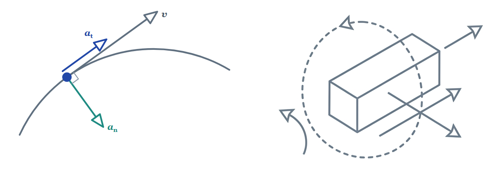
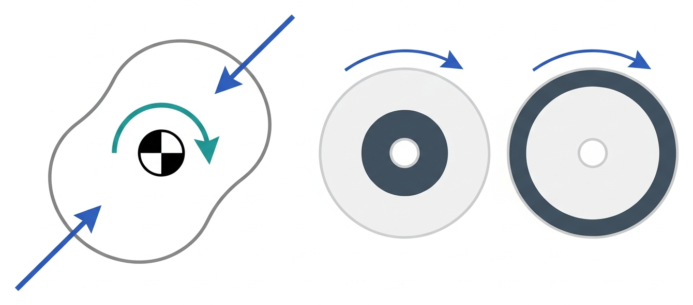
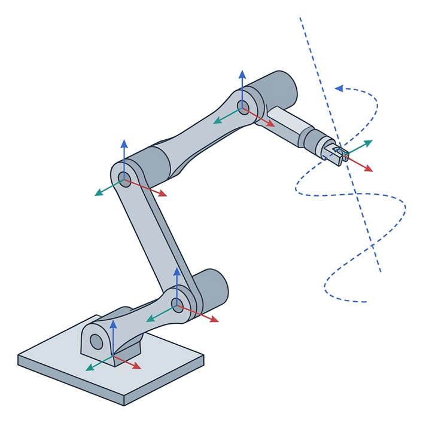
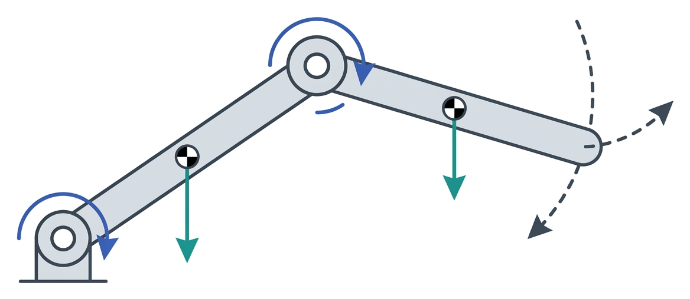

# Kinematics와 Dynamics

## 목차

1. [고전 기구학: 질점과 좌표계](#1-고전-기구학-질점과-좌표계)
2. [강체 기구학과 고전 운동역학](#2-강체-기구학과-고전-운동역학)
3. [로봇 기구학: C-space, 리 군, 스크류 이론, 자코비안](#3-로봇-기구학-c-space-리-군-스크류-이론-자코비안)
4. [다관절 로봇 동역학: 라그랑지안과 재귀 뉴턴–오일러](#4-다관절-로봇-동역학-라그랑지안과-재귀-뉴턴오일러)
5. [References](#references)

---

## 1. 고전 기구학: 질점과 좌표계

> 참고 범위: *Meriam's Engineering Mechanics: Dynamics* Ch. 1–2

### 1.1 동역학의 구조와 모델링

동역학(Dynamics)은 가속하는 물체의 운동을 다루며, 크게 두 영역으로 구분된다.

- **기구학**(Kinematics): 힘이나 질량을 고려하지 않고, 물체의 위치(Position), 속도(Velocity), 가속도(Acceleration) 사이의 순수한 기하학적·시간적 관계를 기술한다.
- **운동역학**(Kinetics): 물체에 작용하는 힘(Force)·모멘트(Moment)와 질량(Mass)·관성(Inertia), 그리고 그 결과로 발생하는 운동 사이의 인과관계를 규명한다.

고전역학에서는 대상 시스템을 두 가지 이상화 모델로 단계적으로 접근한다. **질점**(Particle)은 크기와 모양을 무시하고 질량이 한 점에 집중되어 있다고 가정하는 모델로 회전을 고려하지 않는다. 반면 **강체**(Rigid Body)는 유한한 크기를 가지며 외력 하에서도 내부 임의의 두 점 사이의 거리가 변하지 않는 물체로, 평행이동과 회전을 동시에 다룬다. 모든 운동 방정식은 가속하거나 회전하지 않는 **관성 좌표계**(Inertial / Newtonian Reference Frame)를 기준으로 정식화된다.

### 1.2 직선 운동 (Rectilinear Motion)

단일 직선 경로 $`s(t)`$를 따라 운동하는 질점의 기본 미분 관계는 다음과 같다.

```math
v = \frac{ds}{dt} = \dot{s}, \qquad a = \frac{dv}{dt} = \ddot{s}, \qquad a\,ds = v\,dv
```

세 번째 식 $`a\,ds = v\,dv`$는 앞선 두 식에서 시간 $`dt`$를 소거해 얻으며, 가속도와 변위만으로 속력 변화를 직접 연결한다. 이 관계를 양변 적분하면 일–에너지 원리의 수학적 기반이 된다.

### 1.3 평면 곡선 운동과 3가지 좌표계

곡선 경로를 따라 운동하는 물체의 위치 $`\mathbf{r}(t)`$, 속도 $`\mathbf{v} = \dot{\mathbf{r}}`$, 가속도 $`\mathbf{a} = \dot{\mathbf{v}}`$는 모두 벡터량이다. 속도 벡터는 항상 경로의 접선 방향을 향하는 반면, 가속도 벡터는 경로의 곡률 안쪽으로 향하는 성분을 포함하므로 속력이 일정하더라도 방향이 변하면 가속도는 $`0`$이 아니다.

평면 곡선 운동은 해석 목적에 따라 세 가지 좌표계로 기술된다.

1. **직교 좌표계** (Rectangular Coordinates, $`x\text{-}y`$)
   공간에 고정된 직교 단위벡터 $`\mathbf{i}, \mathbf{j}`$를 사용한다. 단위벡터의 방향이 시간에 따라 변하지 않으므로 미분이 단순하며, 포물선 운동처럼 각 축 방향의 운동이 독립적일 때 적합하다.

   ```math
   \mathbf{v} = \dot{x}\mathbf{i} + \dot{y}\mathbf{j}, \qquad \mathbf{a} = \ddot{x}\mathbf{i} + \ddot{y}\mathbf{j}
   ```

2. **법선·접선 좌표계** (Normal and Tangential Coordinates, $`n\text{-}t`$)
   운동하는 물체에 부착된 접선 단위벡터 $`\mathbf{e}_t`$(진행 방향)와 법선 단위벡터 $`\mathbf{e}_n`$(곡률 중심 방향)을 사용한다. 여기서 $`\rho`$는 해당 지점의 곡률 반지름이다.

   ```math
   \mathbf{v} = v\mathbf{e}_t, \qquad \mathbf{a} = \dot{v}\mathbf{e}_t + \frac{v^2}{\rho}\mathbf{e}_n
   ```

   접선 가속도 $`a_t = \dot{v}`$는 속력 크기의 변화를, 법선 가속도 $`a_n = v^2/\rho`$는 진행 방향의 변화를 명확히 분리해 표현한다.

3. **극좌표계** (Polar Coordinates, $`r\text{-}\theta`$)
   고정 원점으로부터의 거리 $`r`$과 각도 $`\theta`$를 사용한다. 단위벡터 $`\mathbf{e}_r, \mathbf{e}_\theta`$ 자체가 물체를 따라 회전하므로 시간 미분 시 추가 항이 발생한다.

   ```math
   \mathbf{v} = \dot{r}\mathbf{e}_r + r\dot{\theta}\mathbf{e}_\theta, \qquad \mathbf{a} = \left(\ddot{r} - r\dot{\theta}^2\right)\mathbf{e}_r + \left(r\ddot{\theta} + 2\dot{r}\dot{\theta}\right)\mathbf{e}_\theta
   ```

   여기서 $`-r\dot{\theta}^2`$는 회전에 의한 구심 가속도이며, $`2\dot{r}\dot{\theta}`$는 반경 변화($`\dot{r} \neq 0`$)와 회전($`\dot{\theta} \neq 0`$)이 동시에 발생할 때 나타나는 **코리올리 가속도**(Coriolis Acceleration)이다.

### 1.4 3차원 확장 및 상대 운동

평면 극좌표계에 높이축 $`z`$를 추가하면 **원통 좌표계**($`r\text{-}\theta\text{-}z`$), 원점 거리 $`R`$과 두 각도 $`\theta, \phi`$를 사용하면 **구면 좌표계**($`R\text{-}\theta\text{-}\phi`$)로 확장된다. 두 물체 $`A, B`$가 동시에 운동할 때, $`B`$에 고정되어 회전하지 않고 평행이동만 하는 기준 좌표계에 대한 **상대 운동**(Relative Motion)은 다음과 같이 벡터 합으로 표현된다.

```math
\mathbf{r}_A = \mathbf{r}_B + \mathbf{r}_{A/B}, \qquad \mathbf{v}_A = \mathbf{v}_B + \mathbf{v}_{A/B}, \qquad \mathbf{a}_A = \mathbf{a}_B + \mathbf{a}_{A/B}
```

---

## 2. 강체 기구학과 고전 운동역학

> 참고 범위: *Meriam's Engineering Mechanics: Dynamics* Ch. 3, 5, 6, 7

### 2.1 강체 평면 기구학

강체는 변형되지 않으므로 강체 위의 모든 점은 동일한 각속도 $`\boldsymbol{\omega} = \dot{\theta}\mathbf{k}`$와 각가속도 $`\boldsymbol{\alpha} = \dot{\boldsymbol{\omega}} = \ddot{\theta}\mathbf{k}`$를 공유한다. 강체의 일반 평면 운동은 기준점 $`B`$의 평행이동과 $`B`$ 주위의 순수 회전의 합으로 분해된다.

```math
\mathbf{v}_A = \mathbf{v}_B + \boldsymbol{\omega} \times \mathbf{r}_{A/B}
```

```math
\mathbf{a}_A = \mathbf{a}_B + \boldsymbol{\alpha} \times \mathbf{r}_{A/B} + \boldsymbol{\omega} \times \left(\boldsymbol{\omega} \times \mathbf{r}_{A/B}\right)
```

여기서 $`\boldsymbol{\alpha} \times \mathbf{r}_{A/B}`$는 회전에 의한 접선 가속도, $`\boldsymbol{\omega} \times (\boldsymbol{\omega} \times \mathbf{r}_{A/B})`$는 기준점 $`B`$를 향하는 구심 가속도이다.


*그림 1: 질점의 곡선 가속도와 강체의 평행이동·회전 결합 개념도. 왼쪽(Meriam Ch. 2): 곡선 궤적을 따라 움직이는 질점은 진행 방향의 접선 속도(회색 화살표)와 함께 속력을 바꾸는 접선 성분(코발트색)·방향을 꺾는 법선 성분(청록색)으로 가속도가 분해된다. 오른쪽(Meriam Ch. 5): 크기가 있는 강체의 운동은 기준점의 평행이동과 그 점 주위의 회전이 결합된 형태로 해석된다.*

> **순간 속도 중심 (Instantaneous Center of Zero Velocity, IC)**
> 평면 운동하는 강체에는 매 순간 속도가 $`0`$이 되는 점(IC)이 존재하며, 해당 순간 강체 전체의 속도 분포는 IC를 축으로 하는 순수 회전과 등가이다. 이 기하학적 개념은 3차원 공간의 스크류 축(Screw Axis) 이론으로 확장된다.

관찰 좌표계 자체가 각속도 $`\boldsymbol{\omega}`$로 회전하는 경우, 회전 좌표계 내부에서 상대 속도 $`\mathbf{v}_{\mathrm{rel}}`$로 이동하는 점의 절대 가속도에는 코리올리 가속도 항 $`2\boldsymbol{\omega} \times \mathbf{v}_{\mathrm{rel}}`$이 추가된다.

### 2.2 운동역학의 3가지 해석 방법

고전 운동역학은 동일한 물리 현상을 뉴턴 제2법칙의 형태(순간 방정식, 변위 적분, 시간 적분)에 따라 세 가지 관점으로 정식화한다.

1. **힘·질량·가속도** (Force, Mass, and Acceleration)
   강체의 평면 운동은 질량 중심 $`G`$의 병진 방정식과 $`G`$ 주위의 회전 방정식으로 기술되며, 자유물체도(Free-Body Diagram, FBD)를 통해 모든 외력과 구속 반력을 명시한다.

   ```math
   \sum \mathbf{F} = m\bar{\mathbf{a}}, \qquad \sum M_G = \bar{I}\alpha
   ```

2. **일과 에너지** (Work and Energy)
   뉴턴 제2법칙을 이동 경로에 대해 적분해 얻는 스칼라 방정식이다. 강체의 운동에너지는 병진 에너지와 회전 에너지의 합으로 표현된다.

   ```math
   T = \frac{1}{2}m\bar{v}^2 + \frac{1}{2}\bar{I}\omega^2, \qquad U_{1\text{-}2} = \Delta T = T_2 - T_1
   ```

   비보존력이 한 일 $`U'_{1\text{-}2}`$을 분리하면 $`U'_{1\text{-}2} = \Delta T + \Delta V`$로 정리되며, 중력·탄성력 등 보존력만 작용할 경우 역학적 에너지가 보존된다($`T_1 + V_1 = T_2 + V_2`$). 일을 하지 않는 내부 구속력을 계산에서 배제할 수 있으며, 이 구조는 라그랑지안 동역학으로 직접 이어진다.

3. **충격량과 운동량** (Impulse and Momentum)
   뉴턴 제2법칙을 시간에 대해 적분해 선운동량 $`\mathbf{G} = m\bar{\mathbf{v}}`$와 각운동량 $`H_G = \bar{I}\omega`$의 변화량으로 나타낸다.

   ```math
   \int_{t_1}^{t_2} \sum \mathbf{F}\,dt = \Delta \mathbf{G}, \qquad \int_{t_1}^{t_2} \sum M_G\,dt = \Delta H_G
   ```

   짧은 시간 동안 큰 힘이 작용하는 충돌(Impact, 반발계수 $`e`$)이나 외력이 없는 시스템의 운동량 보존 해석에 적합하다.

| 해석 방법 | 핵심 방정식 (평면 강체) | 특징 및 주요 적용 영역 | 로봇 동역학 확장 |
| :--- | :--- | :--- | :--- |
| 힘·질량·가속도 | $`\sum \mathbf{F} = m\bar{\mathbf{a}}`$, $`\sum M_G = \bar{I}\alpha`$ | 특정 순간의 가속도와 관절 내부의 구속 반력을 직접 도출 | 재귀 뉴턴–오일러 알고리즘 (MR Ch. 8.3) |
| 일·에너지 | $`U'_{1\text{-}2} = \Delta T + \Delta V`$ | 스칼라 정식화로 내부 구속력을 소거하고 변위–속력 관계 도출 | 라그랑지안 동역학 $`\mathcal{L} = \mathcal{K} - \mathcal{P}`$ (MR Ch. 8.1) |
| 충격량·운동량 | $`\int \mathbf{F}\,dt = \Delta(m\bar{\mathbf{v}})`$, $`\int M_G\,dt = \Delta(\bar{I}\omega)`$ | 충돌(반발계수 $`e`$) 및 외력이 없는 계의 운동량 보존 해석 | 접촉·충돌 역학 및 공간 운동량 보존 |

### 2.3 질량 관성모멘트와 3차원 관성 텐서

회전 운동에서 각가속도에 저항하는 물성치는 **질량 관성모멘트**(Mass Moment of Inertia)로 정의된다.

```math
I = \int r^2\,dm, \qquad I = \bar{I} + md^2 \quad \text{(Parallel-Axis Theorem)}
```

질량 분포가 회전축으로부터 멀어질수록 거리 $`r`$의 제곱에 비례해 회전 관성이 증가하며, 회전축이 질량 중심으로부터 거리 $`d`$만큼 평행 이동하면 $`md^2`$만큼 가산된다.


*그림 2: 강체의 힘·토크 자유물체도와 질량 분포에 따른 관성모멘트 차이 개념도. 왼쪽: 강체의 질량 중심(체크 원)을 기준으로 작용하는 외력(코발트색 화살표)은 평행이동 가속도를, 중심 주위의 모멘트(청록색 곡선 화살표)는 회전 각가속도를 생성한다. 오른쪽: 동일한 크기와 질량의 원판이라도 질량이 중심 허브에 집중된 경우보다 바깥 테두리에 분포한 경우($`r`$이 클수록) 회전 관성 $`I = \int r^2\,dm`$이 크게 증가한다.*

3차원 강체 운동에서는 회전축이 고정되지 않으므로 관성 특성이 $`3 \times 3`$ 대칭 행렬인 **관성 텐서**(Inertia Tensor) $`\mathcal{I}_b`$로 확장된다. 대각 성분($`I_{xx}, I_{yy}, I_{zz}`$)은 각 좌표축 주위의 회전 관성을, 비대각 성분(관성곱, Products of Inertia)은 비대칭 질량 분포로 인한 축 간 동적 결합 효과를 나타낸다.

---

## 3. 로봇 기구학: C-space, 리 군, 스크류 이론, 자코비안

> 참고 범위: *Modern Robotics: Mechanics, Planning, and Control* Ch. 2–6

### 3.1 형상 공간(C-space)과 자유도(DOF)

여러 강체 링크(Link)가 관절(Joint)로 연결된 매니퓰레이터에서, 로봇의 모든 점의 위치를 유일하게 결정하는 상태 표현을 **형상**(Configuration)이라 하며 가능한 모든 형상의 집합을 **형상 공간**(Configuration Space, C-space)이라 정의한다.

형상을 완전히 결정하는 데 필요한 최소 독립 변수의 개수가 **자유도**(Degrees of Freedom, DOF)이다. 자유 강체는 평면에서 $`3\text{-DOF}`$($`x, y, \theta`$), 3차원 공간에서 $`6\text{-DOF}`$(병진 3 + 회전 3)를 가진다. $`N`$개의 링크(고정 베이스 포함)와 $`J`$개의 관절로 구성된 기구의 자유도는 **그뤼블러 공식**(Grübler's Formula)으로 계산된다.

```math
\mathrm{dof} = m(N - 1 - J) + \sum_{i=1}^{J} f_i
```

여기서 평면 기구는 $`m = 3`$, 공간 기구는 $`m = 6`$이며, $`f_i`$는 $`i`$번째 관절이 허용하는 자유도이다(회전·직동 관절은 $`f_i = 1`$).

C-space는 일반적으로 비유클리드 다양체(Manifold) 구조를 가진다. 예를 들어 $`360^\circ`$ 회전 관절 하나는 원 $`S^1`$의 위상을, 두 개의 회전 관절은 토러스 $`T^2 = S^1 \times S^1`$의 위상을 가진다. 형상 변수 자체에 부과되는 제약은 **홀로노믹**(Holonomic) 구속, 적분 불가능한 속도 제약은 **비홀로노믹**(Nonholonomic) 구속으로 분류된다.

### 3.2 3차원 강체 운동: $`SO(3)`$, $`SE(3)`$, 트위스트와 렌치

현대 로봇 기구학은 리 군(Lie Group)과 스크류 이론(Screw Theory)을 통해 3차원 강체 운동을 좌표계 독립적으로 정식화한다.

- **회전행렬** $`R \in SO(3)`$: 3차원 공간에서 강체의 자세(Orientation)를 표현하는 $`3 \times 3`$ 행렬이다. 특수 직교군 $`SO(3)`$의 원소는 직교 조건 $`R^\top R = I`$와 오른손 좌표계 보존 조건 $`\det R = 1`$을 만족한다.
- **지수 좌표와 로드리게스 공식** (Rodrigues' Formula): 임의의 3차원 회전은 단위 회전축 $`\hat{\boldsymbol{\omega}}`$ 주위의 각도 $`\theta`$ 회전으로 표현된다. 외적 연산을 행렬화한 반대칭 행렬 $`[\hat{\boldsymbol{\omega}}] \in \mathfrak{so}(3)`$에 대한 행렬 지수함수로 회전행렬이 도출된다.

  ```math
  R = e^{[\hat{\boldsymbol{\omega}}]\theta} = I + \sin\theta\,[\hat{\boldsymbol{\omega}}] + (1 - \cos\theta)[\hat{\boldsymbol{\omega}}]^2
  ```

- **동차변환행렬** $`T \in SE(3)`$: 회전 $`R \in SO(3)`$과 위치 벡터 $`\mathbf{p} \in \mathbb{R}^3`$을 단일 $`4 \times 4`$ 행렬로 통합해 강체의 완전한 자세(Pose)를 나타낸다.

  ```math
  T = \begin{bmatrix} R & \mathbf{p} \\ \mathbf{0}^\top & 1 \end{bmatrix} \in SE(3)
  ```

- **트위스트(Twist), 스크류 축(Screw Axis), 렌치(Wrench)**: Chasles–Mozzi 정리에 따라 3차원 강체의 모든 변위는 단일 공간 축(스크류 축 $`\mathcal{S} = (\boldsymbol{\omega}, \mathbf{v}) \in \mathbb{R}^6`$)을 따른 회전과 축 방향 병진의 결합으로 표현되며, 이의 $`4 \times 4`$ 행렬 표현은 $`[\mathcal{S}] \in \mathfrak{se}(3)`$로 표기한다. 6차원 공간 속도를 **트위스트** $`\mathcal{V} = (\boldsymbol{\omega}, \mathbf{v}) \in \mathbb{R}^6`$, 6차원 모멘트·힘을 **렌치** $`\mathcal{F} = (\mathbf{m}, \mathbf{f}) \in \mathbb{R}^6`$라 정의하며, 두 벡터는 일률($`\mathrm{Power} = \mathcal{F}^\top \mathcal{V}`$)을 통해 쌍대(Dual) 관계를 이룬다. 서로 다른 좌표계 간의 트위스트·렌치 변환은 $`6 \times 6`$ **수반 행렬**(Adjoint Matrix) $`[\mathrm{Ad}_T]`$로 수행된다.


*그림 3: 3차원 다관절 로봇 팔의 국소 좌표계와 스크류 운동 개념도(Modern Robotics Ch. 3–4). 베이스와 각 회전 관절, 말단 장치에 직교 $`XYZ`$ 좌표계(빨강·청록·코발트 축)가 정의되며, 관절 회전의 연속적 결합은 말단 장치의 3차원 자세 $`T(\theta) \in SE(3)`$와 나선형 스크류 경로(파란 점선)를 결정한다.*

### 3.3 정기구학 (Forward Kinematics): 지수곱 공식

정기구학은 주어진 관절 각도 벡터 $`\theta = (\theta_1, \dots, \theta_n)^\top`$로부터 말단 장치(End-Effector)의 공간 자세 $`T(\theta) \in SE(3)`$를 계산하는 문제이다. 링크마다 국소 좌표계를 정의해야 하는 전통적 Denavit–Hartenberg(D-H) 파라미터와 달리, **지수곱 공식**(Product of Exponentials, PoE)은 홈 자세 $`M \in SE(3)`$과 공간 고정 좌표계 기준 각 관절의 스크류 축 행렬 $`[\mathcal{S}_i] \in \mathfrak{se}(3)`$만으로 정기구학을 간결하게 표현한다.

```math
T(\theta) = e^{[\mathcal{S}_1]\theta_1} e^{[\mathcal{S}_2]\theta_2} \cdots e^{[\mathcal{S}_n]\theta_n} M
```

### 3.4 속도 기구학, 정역학, 특이점: 자코비안

**자코비안 행렬**(Jacobian) $`J(\theta)`$는 관절 속도 $`\dot{\theta}`$를 말단 장치의 6차원 트위스트 $`\mathcal{V}`$로 매핑한다. 자코비안의 $`i`$번째 열은 $`i`$번째 관절만 단위 속도로 구동했을 때 발생하는 말단 트위스트에 해당한다.

```math
\mathcal{V} = J(\theta)\dot{\theta}, \qquad \tau = J^\top(\theta)\mathcal{F}
```

가상일의 원리($`\tau^\top \dot{\theta} = \mathcal{F}^\top \mathcal{V}`$)에 의해 자코비안의 전치 행렬 $`J^\top(\theta)`$는 말단이 환경에 가하는 렌치 $`\mathcal{F}`$(즉, 말단에 작용하는 외력 $`-\mathcal{F}`$에 대항하여 정적 평형을 유지하기 위한 힘)와 관절 토크 $`\tau`$를 직접 연결한다.

특정 형상 $`\theta`$에서 자코비안 $`J(\theta)`$의 랭크(Rank)가 감소해 특정 방향의 이동 자유도를 상실하는 상태를 **기구학적 특이점**(Kinematic Singularity)이라 한다. 특이점 근방에서는 말단의 미세한 변위에도 관절 속도가 발산하며, 각 방향의 속도·힘 전달 효율은 **조작성 타원체**(Manipulability Ellipsoid)로 정량화된다.

### 3.5 역기구학 (Inverse Kinematics)

역기구학은 목표 말단 자세 $`T_{sd} \in SE(3)`$를 달성하는 관절 각도 $`\theta`$를 구하는 문제이다. 정기구학과 달리 작업 공간 외부에서는 해가 존재하지 않으며, 작업 공간 내부에서도 복수의 해(다중해)가 존재할 수 있다. 단순 구조의 매니퓰레이터는 기하학적 해석해(Analytic IK)를 도출할 수 있으나, 일반적인 다관절 로봇에서는 말단 좌표계 기준의 오차 트위스트 $`\mathcal{V}_b`$와 바디 자코비안 의사역행렬 $`J_b^\dagger(\theta^i)`$를 이용해 각도를 반복 갱신하는 **수치적 역기구학**(Newton–Raphson 방법)이 사용된다.

---

## 4. 다관절 로봇 동역학: 라그랑지안과 재귀 뉴턴–오일러

> 참고 범위: *Modern Robotics: Mechanics, Planning, and Control* Ch. 8

### 4.1 표준 로봇 동역학 방정식

개방 연쇄(Open-Chain) 다관절 로봇에서 관절 토크 벡터 $`\tau \in \mathbb{R}^n`$와 관절 운동 상태 $`(\theta, \dot{\theta}, \ddot{\theta})`$ 사이의 동역학 방정식은 다음의 표준 형태로 귀결된다.

```math
\tau = M(\theta)\ddot{\theta} + c(\theta, \dot{\theta}) + g(\theta)
```

- **관성 항** $`M(\theta)\ddot{\theta}`$: $`M(\theta) \in \mathbb{R}^{n \times n}`$는 대칭 양의 정부호(Symmetric Positive-Definite) 질량/관성 행렬로, 로봇의 형상 $`\theta`$에 따라 실시간으로 변한다.
- **코리올리·원심 항** $`c(\theta, \dot{\theta})`$: 관절 속도 $`\dot{\theta}`$에 의해 발생하는 비선형 속도 의존 항으로, 다관절 링크 간의 동적 상호 간섭을 포함한다.
- **중력 항** $`g(\theta)`$: 정지 상태에서도 각 링크의 자중을 지지하기 위해 필요한 형상 의존적 중력 보상 토크이다.

원하는 궤적 $`(\theta, \dot{\theta}, \ddot{\theta})`$을 추종하기 위한 토크 $`\tau`$를 계산하는 문제를 **역동역학**(Inverse Dynamics), 주어진 토크 $`\tau`$에 따른 관절 가속도 $`\ddot{\theta} = M(\theta)^{-1}(\tau - c(\theta, \dot{\theta}) - g(\theta))`$를 계산하는 문제를 **정동역학**(Forward Dynamics)이라 한다.

### 4.2 라그랑지안 정식화 (Lagrangian Formulation)

라그랑지안 정식화는 시스템의 총 운동에너지 $`\mathcal{K}(\theta, \dot{\theta}) = \frac{1}{2}\dot{\theta}^\top M(\theta)\dot{\theta}`$와 총 위치에너지 $`\mathcal{P}(\theta)`$의 차이로 정의되는 스칼라 함수 $`\mathcal{L}`$에 오일러–라그랑주 방정식을 적용한다.

```math
\mathcal{L}(\theta, \dot{\theta}) = \mathcal{K}(\theta, \dot{\theta}) - \mathcal{P}(\theta), \qquad \tau_i = \frac{d}{dt}\frac{\partial \mathcal{L}}{\partial \dot{\theta}_i} - \frac{\partial \mathcal{L}}{\partial \theta_i} \quad (i = 1, \dots, n)
```

자유물체도를 통해 내부 관절 구속 반력을 명시적으로 계산할 필요 없이 에너지 미분만으로 $`M(\theta), c(\theta, \dot{\theta}), g(\theta)`$의 닫힌 형태(Closed-Form) 구조를 직접 도출할 수 있다.


*그림 4: 2링크 평면 로봇 팔의 관절 토크·중력·운동 상호작용 개념도. 베이스와 팔꿈치 회전 관절에 가해지는 모터 토크(코발트색 곡선 화살표)는 각 링크 질량 중심에 작용하는 중력(청록색 직선 화살표, $`g(\theta)`$)과 링크의 가속 관성($`M(\theta)\ddot{\theta}`$), 속도 간섭($`c(\theta, \dot{\theta})`$)을 보상하며 말단의 운동 궤적(점선)을 생성한다.*

### 4.3 재귀 뉴턴–오일러 알고리즘 (Recursive Newton–Euler, RNEA)

관절 수 $`n`$이 증가할수록 라그랑지안의 기호 미분 비용이 급격히 커지므로, 실시간 제어 및 물리 시뮬레이션에서는 6차원 공간 동역학을 재귀적으로 계산하는 **RNEA**가 표준으로 사용된다.

각 링크 $`i`$의 질량 $`m_i`$와 3차원 관성 텐서 $`\mathcal{I}_i`$를 $`6 \times 6`$ **공간 관성 행렬**(Spatial Inertia Matrix) $`\mathcal{G}_i`$로 통합하면, 단일 강체에 작용하는 합렌치(Net Wrench) $`\mathcal{F}_i^{\mathrm{net}}`$에 대한 3차원 뉴턴–오일러 방정식이 다음과 같이 결합된다.

```math
\mathcal{F}_i^{\mathrm{net}} = \mathcal{G}_i \dot{\mathcal{V}}_i - [\mathrm{ad}_{\mathcal{V}_i}]^\top \mathcal{G}_i \mathcal{V}_i
```

RNEA는 두 단계의 순회로 $`O(n)`$ 복잡도 내에 역동역학을 계산한다.

- **Forward Pass (베이스 → 말단)**: 링크 $`1 \to n`$ 순서로 각 링크의 6차원 트위스트 $`\mathcal{V}_i`$와 가속도 $`\dot{\mathcal{V}}_i`$를 누적 전파한다(중력은 베이스에 $`+g`$의 상향 가속도를 부여해 등가 처리한다).
- **Backward Pass (말단 → 베이스)**: 링크 $`n \to 1`$ 순서로 말단 외력과 인접 링크 반력을 합산해 각 관절이 링크 $`i`$에 전달하는 관절 렌치 $`\mathcal{F}_i`$를 역산하고, 이를 관절 스크류 축 $`\mathcal{A}_i`$에 투영해 모터 토크 $`\tau_i = \mathcal{F}_i^\top \mathcal{A}_i`$를 얻는다.

| 정식화 방식 | 출발 원리 | 이론·분석 관점 강점 | 계산·실무 관점 특징 |
| :--- | :--- | :--- | :--- |
| 라그랑지안 (Lagrangian) | $`\mathcal{L} = \mathcal{K}(\theta, \dot{\theta}) - \mathcal{P}(\theta)`$ | 스칼라 에너지 기반으로 구속력을 자동 소거하여 $`M, c, g`$의 수학적 구조 분석에 용이 | 관절 수 $`n`$이 증가할수록 수식 전개 비용이 급증해 실시간 계산에는 불리 |
| 재귀 뉴턴–오일러 (RNEA) | $`\mathcal{F}_i^{\mathrm{net}} = \mathcal{G}_i \dot{\mathcal{V}}_i - [\mathrm{ad}_{\mathcal{V}_i}]^\top \mathcal{G}_i \mathcal{V}_i`$ | 링크 간에 작용하는 실제 내부 관절 힘·모멘트(렌치)까지 산출 가능 | 계산 복잡도가 $`O(n)`$으로 선형 비례하여 실시간 역동역학 제어의 표준으로 활용 |

### 4.4 확장 영역: 작업 공간 동역학 및 반사 관성

실제 로봇 시스템 적용 시에는 관절 공간 방정식을 말단 좌표계로 변환한 **작업 공간 동역학**(Dynamics in Task Space)과, 감속기 기어비 $`G`$에 의해 증폭되는 액추에이터의 **반사 관성**(Reflected Inertia, $`\propto G^2 I_{\mathrm{motor}}`$)이 중요하게 고려된다. 높은 기어비의 감속기를 사용하는 산업용 매니퓰레이터에서는 모터 로터의 반사 관성이 링크 자체의 관성을 지배해 비선형 결합 항의 영향을 완화하는 특성을 보인다.

이러한 기구학 및 동역학 모델은 이후 **궤적 생성**(Trajectory Generation), **경로 계획**(Motion Planning), **로봇 제어**(Robot Control: PD 제어 + 중력 보상, 계산 토크 제어 등)의 기반 모델로 직접 활용된다.

---

## References

1. J. L. Meriam, L. G. Kraige, & J. N. Bolton, *Engineering Mechanics: Dynamics*, 9th Edition, SI Version, Wiley.
2. K. M. Lynch & F. C. Park, *Modern Robotics: Mechanics, Planning, and Control*, Cambridge University Press.
